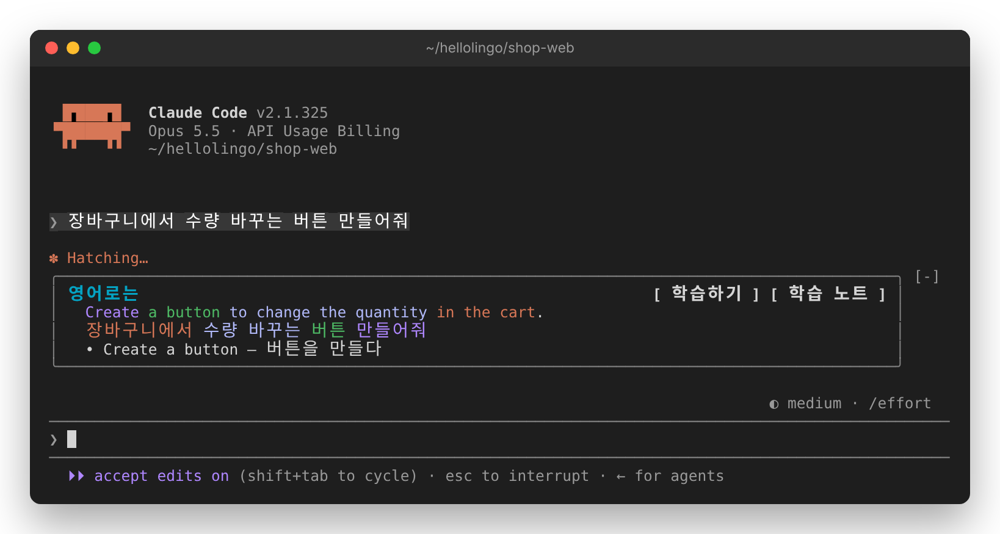
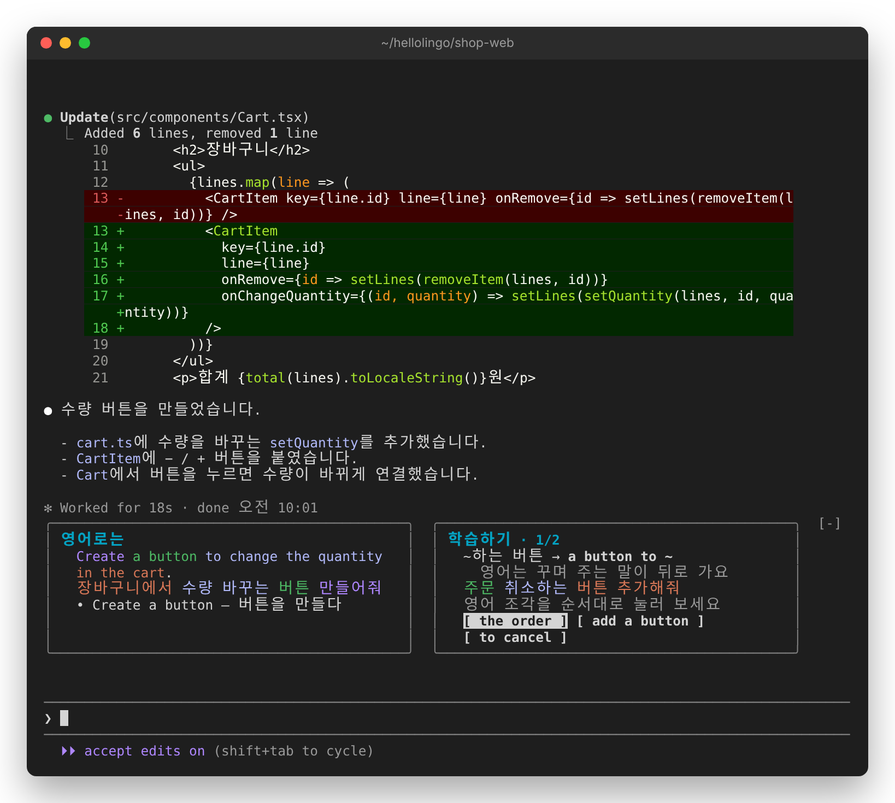

# hellolingo

[English summary](#in-english)

Claude와 일하는 동안 영어가 조금씩 늘게 돕는 Claude Code 플러그인입니다. 한국어로 일을 시키면, 그 문장을 영어로 보여 줍니다. 원할 때 그 문장으로 연습하고, 나중에 다시 떠올립니다.

따로 공부할 시간을 낼 필요가 없습니다. 평소처럼 프롬프트를 보내면 됩니다. 공부는 Claude가 일하는 동안, 카드의 단추를 누를 때만 합니다. 지금은 영어를 배웁니다. 일본어, 중국어, 비즈니스 용어도 차례로 넣을 계획입니다.

## 이렇게 배웁니다

1. **보기.** 프롬프트를 보내면 입력창 위에 영어 문장이 나옵니다. 같은 뜻의 조각은 같은 색입니다.
2. **학습하기.** 원하면 `학습하기`를 누릅니다. 그 문장에서 막히기 쉬운 곳 하나를, 같은 틀의 새 문장 두 개로 연습합니다.
3. **모으기.** 다시 쓸 만한 표현 하나가 노트에 저절로 모입니다.
4. **떠올리기.** 다음 날부터 `복습` 단추에 복습할 표현 수가 나옵니다. 시간 날 때 눌러서 떠올립니다.

카드는 이렇게 생겼습니다. 위쪽 오른쪽에 단추가 있습니다.



`학습하기`를 누르면 옆에 문제가 나옵니다. 영어 조각을 순서대로 누릅니다.



영어로 프롬프트를 쓰면 틀린 곳을 고쳐 줍니다. 틀린 곳이 없으면 더 자연스러운 말을 하나 알려 줍니다.

## 설치

Claude Code v2.1.311 이상이 필요합니다. 터미널과 데스크톱 앱에서 보입니다. VS Code 확장에서는 보이지 않습니다.

1. Claude Code에 아래 줄을 입력합니다.

   ```
   /plugin install hellolingo --marketplace dnjswhdzld/hellolingo
   ```

2. 새 세션을 엽니다.
3. 한국어로 프롬프트를 보냅니다. 10자 이상이면 카드가 나옵니다.

## 공부하는 법

| 단추 | 키 | 하는 일 |
| --- | --- | --- |
| `학습하기` | `s` | 방금 쓴 문장의 틀을 새 문장 2개로 연습합니다. 영어 조각을 순서대로 누릅니다. |
| `복습 3` | `v` | 복습할 때가 된 표현을 차례로 떠올립니다. 숫자는 복습할 표현 수입니다. |
| `학습 노트` | `b` | 모은 표현을 봅니다. 영어는 가려 두었고, 골라서 떠올립니다. |

- 복습에서는 한국어 뜻을 보고 영어를 머릿속으로 떠올립니다. 쓰지 않아도 됩니다.
- 다 떠올렸으면 `정답 보기`(`r`)를 누릅니다. 떠올렸으면 `o`, 못 떠올렸으면 `x`를 누릅니다.
- 학습하기에서 연습한 틀은 처음 보는 문장의 조각 맞추기로 복습합니다. 조각은 `1`, `2`, `3`으로 고릅니다. 남은 조각을 왼쪽부터 셉니다.
- 떠올릴수록 다음 복습이 늦게 나옵니다. 1일, 3일, 7일, 14일, 30일 뒤입니다.
- 못 떠올려도 괜찮습니다. 다음 날 다시 나옵니다. 떠올리려고 애쓴 것만으로도 기억에 도움이 됩니다.
- 언제든 `닫기`(`q`)를 누릅니다. 정답을 보고 답하지 않고 닫은 표현은 다음 날 다시 나옵니다.

키를 누르기 전에 카드를 한 번 클릭하거나, `ctrl+x`를 누른 다음 `tab`을 눌러 카드로 옮겨 갑니다. 마우스로 단추를 눌러도 됩니다.

## 노트 보기

`/lingo-notes`를 입력하면 모은 표현이 패널에 나옵니다. 영어는 가려 두었고, 표현을 누르면 입력창 위에서 떠올려 봅니다. 맨 위에는 최근 7일 동안 공부한 날과 복습한 수가 나옵니다. 입력창이 빈 채로 `Esc`를 누르면 닫힙니다. 표현이 많으면 `ctrl+x`를 누른 다음 `tab`을 눌러 패널로 옮겨 가고, 아래 방향키로 내려 봅니다.

새 표현은 하루에 5개까지만 모읍니다. 학습하기로 연습한 틀은 5개가 차 있어도 담깁니다. 복습할 표현이 10개 이상 쌓이면, 복습해서 줄어들 때까지 새 표현은 모으지 않습니다. 많이 모으는 것보다 잊지 않는 것이 중요하기 때문입니다.

## 알아 두세요

- **사용량.** 학습할 프롬프트 하나에 haiku 모델을 한 번 부릅니다. `학습하기`를 누를 때도 한 번 부릅니다(쓸 만한 문제가 안 나오면 두 번). Claude Code 사용량에 들어갑니다. 복습과 노트는 모델을 부르지 않습니다.
- **보내는 것.** 내 프롬프트만 haiku에 보냅니다. 백틱 세 개(`` ``` ``)로 감싼 코드 블록은 빼고, 앞 1500자까지입니다. Claude의 답, 코드, 파일은 읽지도 바꾸지도 않습니다.
- **저장.** 노트와 학습 기록은 내 컴퓨터에만 있습니다. `~/.claude/plugins/store/` 폴더의 `hellolingo_`로 시작하는 파일입니다. 지우려면 Claude Code를 모두 닫고 그 파일을 지웁니다.
- **초기 버전.** 이 플러그인이 쓰는 Claude Code 기능이 아직 미리 보기(early access) 단계입니다. Claude Code가 바뀌면 동작이 깨질 수 있습니다.

## 더 읽을거리

- [가이드](docs/guide/README.md). 네 사람이 Claude와 일하는 며칠을 따라가며, 설치부터 학습하기, 복습, 노트, 문제 해결까지 실제 화면으로 보여 줍니다.
- [학습 설계와 근거](docs/learning-design.md). 왜 이렇게 만들었는지, 어떤 연구를 따랐는지 적었습니다.
- [동작 방식](docs/how-it-works.md). 기여하는 사람을 위한 자세한 설명과, 고쳐서 보내는 법입니다.

## In English

hellolingo is a Claude Code plugin for Korean speakers who want to learn English from the prompts they already write while working with Claude.

1. **See.** Send a prompt in Korean and its English version appears above the prompt box. Matching parts of the two sentences share a color.
2. **Study, when you choose.** Press `학습하기` on the card. It picks the one spot in your sentence a Korean speaker most often gets wrong in English (word order or a request chunk) and drills it with two new sentences of the same shape: put the English pieces in order.
3. **Collect.** One reusable expression from each card goes into a notebook on its own, and so does every pattern you studied.
4. **Recall.** From the next day, a `복습 N` button shows how many expressions are due. Press it while Claude works: recall each one in your head (`r` shows the answer, `o` if you recalled it, `x` if not), or arrange a new sentence for a studied pattern. Nothing pops up by itself.

Prompts written in English get their mistakes corrected. It collects at most 5 new expressions a day and pauses when 10 reviews are due. Each learnable prompt goes to haiku once, and each press of `학습하기` once more, through Claude Code's own model call. Daily study counts stay on your machine and show as one line in `/lingo-notes`. It never reads or changes Claude's replies, your code or your files, and your notes stay on your machine. It needs Claude Code v2.1.311 or later and supports Korean to English for now. Japanese, Chinese and business terms are planned. The design and the research behind it are in [docs/learning-design.md](docs/learning-design.md) (Korean).

## 라이선스

MIT. [LICENSE](LICENSE)를 보세요.
