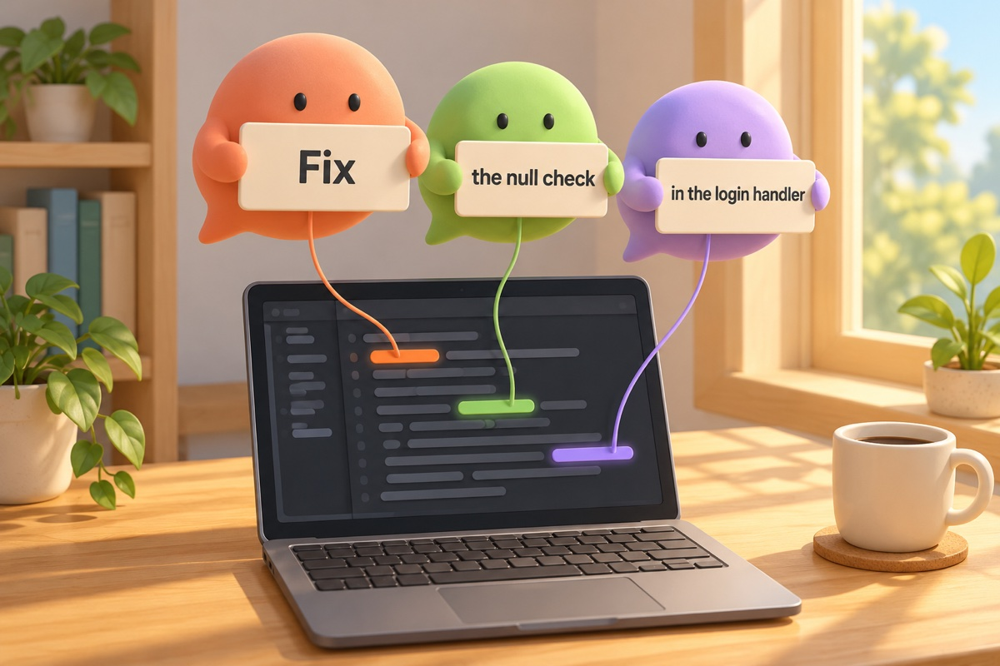
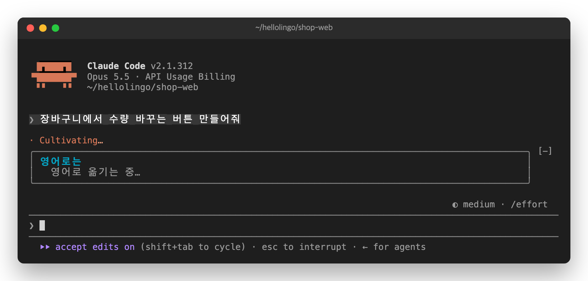
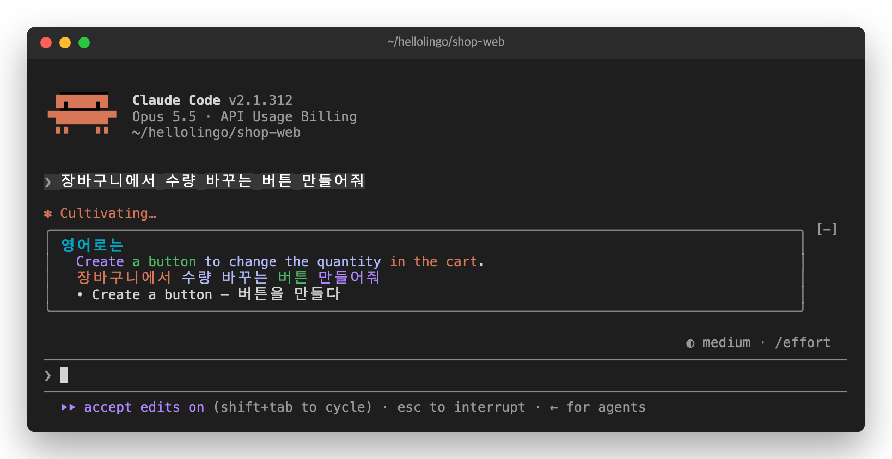
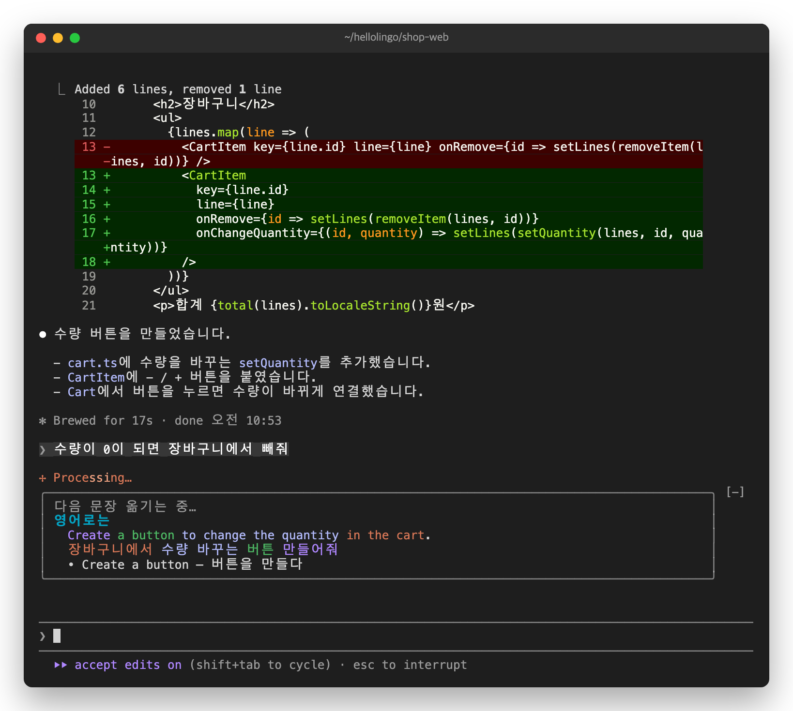
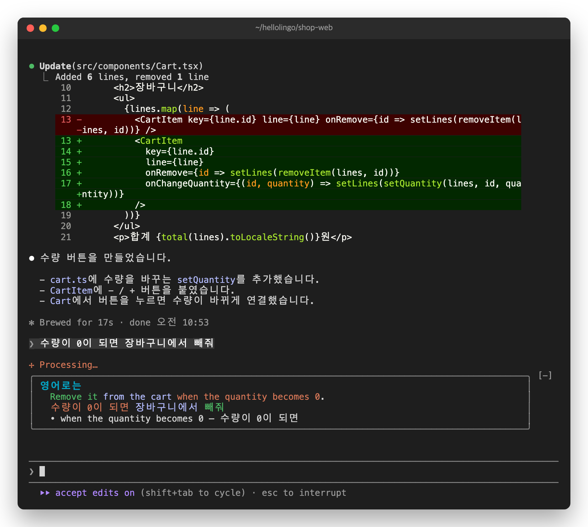
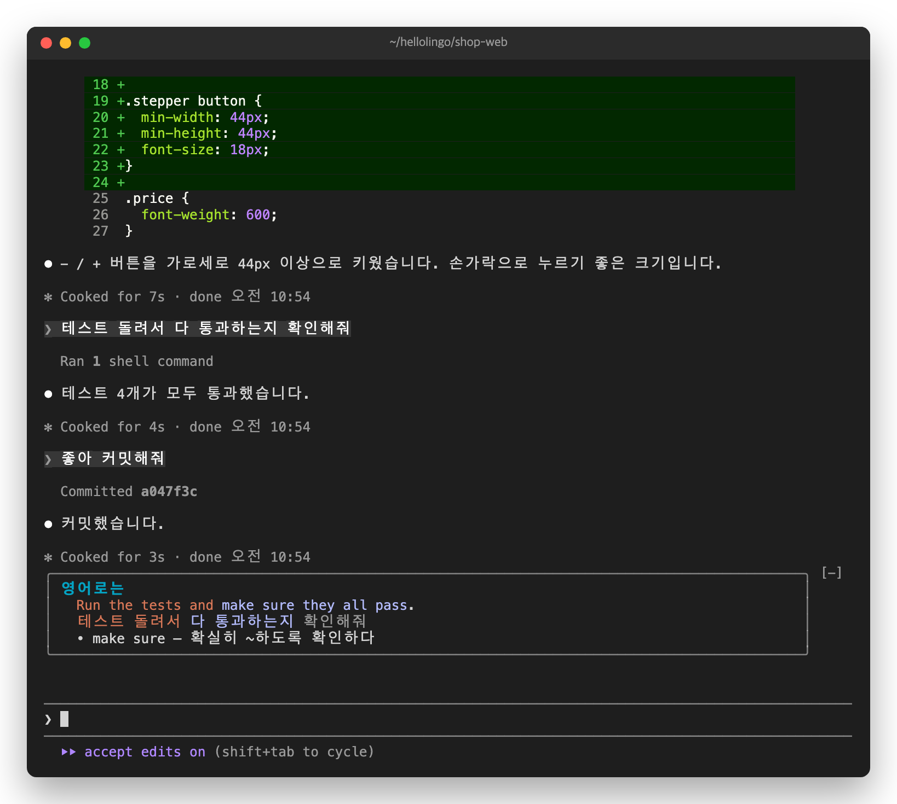

# 2. 보기. 내 문장이 영어로



유진은 작은 쇼핑몰의 화면을 만드는 개발자입니다. 오늘은 장바구니에 수량 버튼을 붙입니다.

## 첫 카드

유진이 Claude에게 일을 시킵니다.

```
장바구니에서 수량 바꾸는 버튼 만들어줘
```

입력창 위에 "영어로 옮기는 중…"이 잠깐 나옵니다.



곧 카드가 나옵니다. Claude는 그동안에도 일을 합니다.



## 카드 읽는 법

- **첫째 줄.** 내 문장을 영어로 쓴 것입니다.
- **둘째 줄.** 내가 쓴 한국어입니다.
- **같은 색은 같은 뜻입니다.** "만들어줘"와 "Create"가 같은 색입니다. 이 문장에서는 부탁하는 말 "Create"가 맨 앞에 옵니다.
- **`•` 줄.** 다시 쓸 만한 핵심 표현입니다. 이 표현이 노트에 모입니다. 하루에 모으는 수에는 한도가 있습니다. [3장](03-collect.md)에서 다룹니다.

## 다음 일을 시키면

유진이 이어서 시킵니다.

```
수량이 0이 되면 장바구니에서 빼줘
```

새 카드가 준비될 때까지 지난 카드가 남아 있습니다. 맨 위에 흐린 글씨로 "다음 문장 옮기는 중…"이 붙습니다. 지금 보이는 카드가 지난 문장의 것이라는 뜻입니다.



곧 새 카드로 바뀝니다.



## 짧은 답장에는 카드가 없습니다

유진은 버튼을 키우고 테스트를 돌린 뒤 "좋아 커밋해줘"라고 답합니다. 10자보다 짧은 말에는 카드를 만들지 않습니다. 그래서 바로 앞 카드가 그대로 남습니다.



## 긴 프롬프트는 한 문장만

프롬프트가 여러 문장이면, 주된 부탁 한 문장만 카드에 옮깁니다. 붙여 넣은 로그나 코드도 빼고 옮깁니다. [5장](05-english.md)에서 예를 봅니다.

다음: [3. 모으기](03-collect.md)
