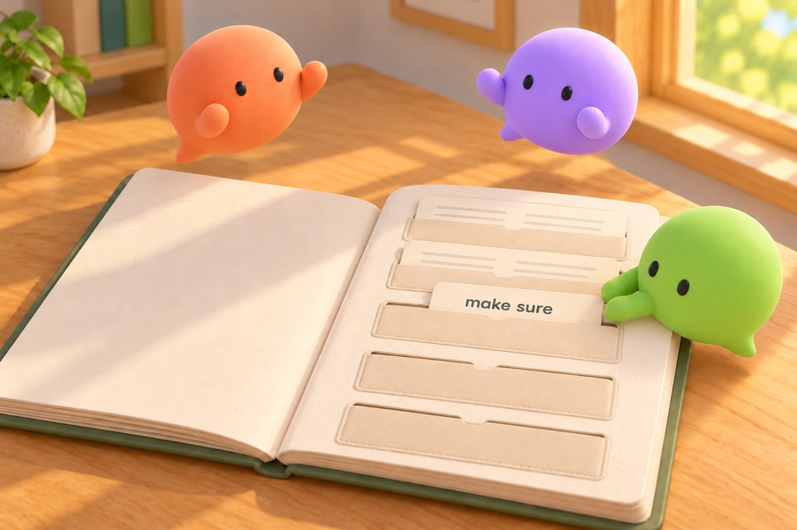
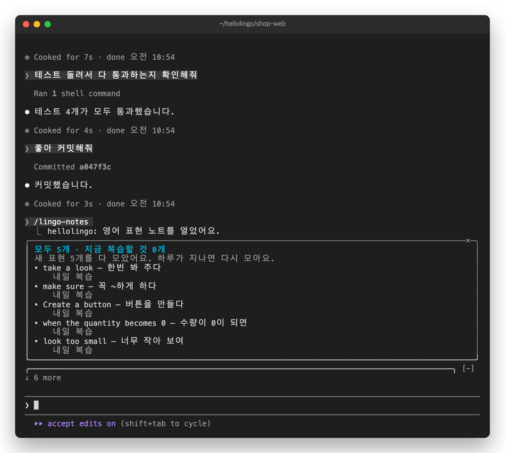

# 3. 모으기. 표현 하나를 노트에



카드 맨 아래 `•` 줄이 그 카드의 핵심 표현입니다. 다른 일을 시킬 때도 또 쓸 만한 말 하나를 골라 노트에 모읍니다.

유진의 오전 카드에서는 이런 표현이 모였습니다.

- Create a button
- when the quantity becomes 0
- look too small

## 노트 보기

입력창에 입력합니다.

```
/lingo-notes
```

모은 표현과, 각각 언제 다시 나오는지 보입니다.



닫으려면 입력창이 빈 채로 `Esc`를 누릅니다. 오른쪽 위 `✕`를 눌러도 됩니다.

## 하루 5개까지만

위 화면 맨 위에 "새 표현 5개를 다 모았어요."가 보입니다. 유진은 아침 일찍 다른 일을 하면서 표현 2개를 모았습니다. 그래서 이번 오전에 5개가 찼습니다.

일부러 그렇게 만들었습니다. 많이 모으는 것보다 잊지 않는 것이 중요하기 때문입니다. 모으지 않는 동안에도 카드는 그대로 나옵니다.

같은 표현은 두 번 모으지 않습니다. 오전 마지막 카드의 "make sure"는 아침에 이미 모은 표현입니다.

다음: [4. 떠올리기](04-recall.md)
