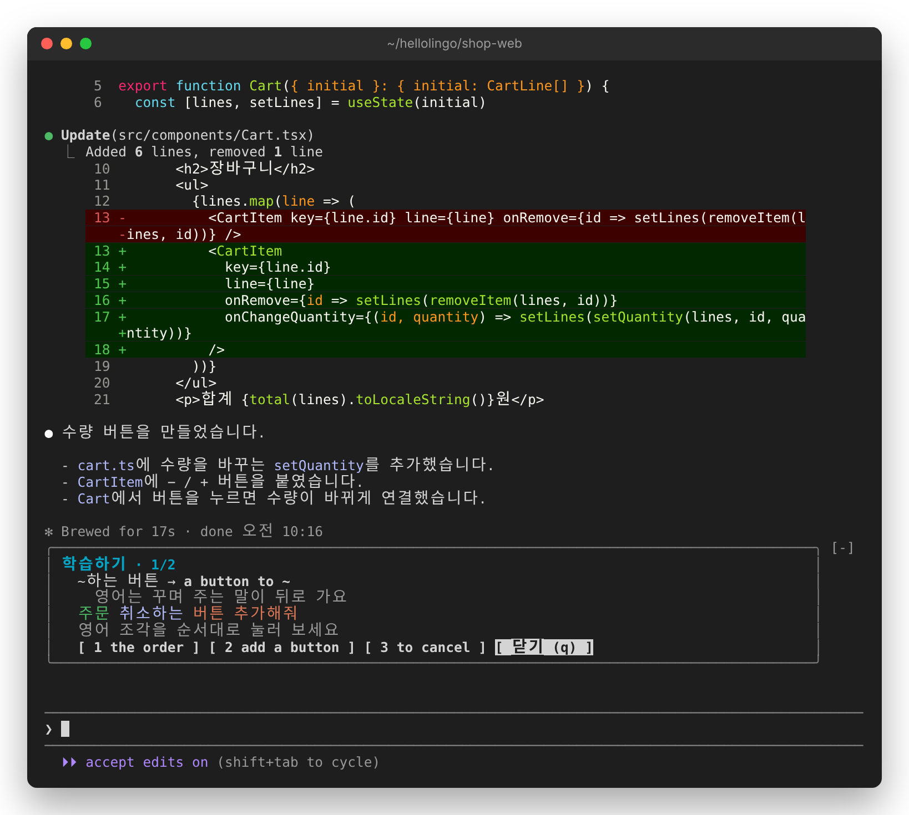
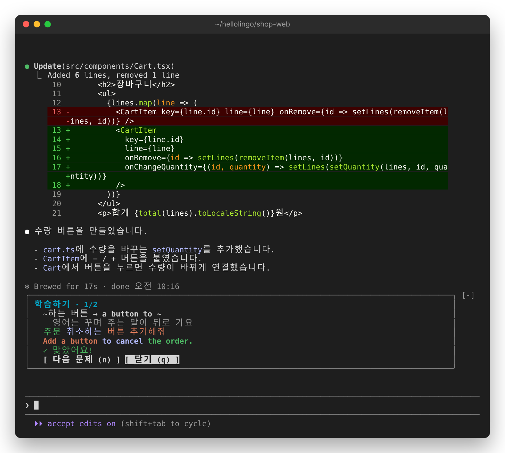
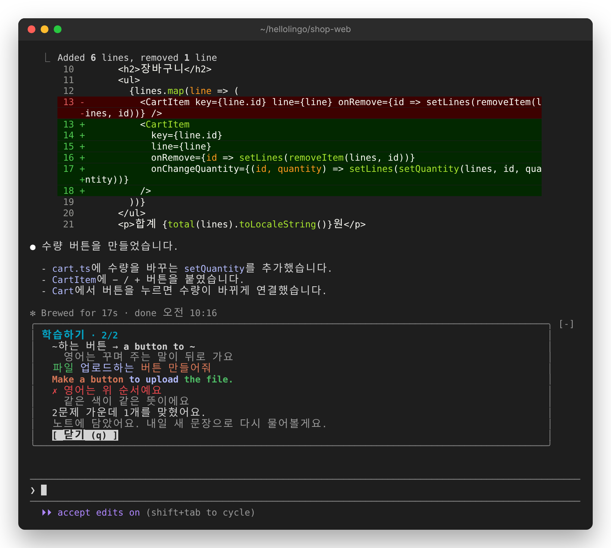

# 3. 학습하기. 방금 쓴 문장으로 연습

유진은 방금 수량 버튼을 시켰습니다. Claude가 일을 마칠 때까지 잠깐 시간이 있습니다. 카드 위쪽 오른쪽의 `학습하기`를 눌러 봅니다. 카드가 있던 자리에 문제가 나옵니다. 공부하는 동안에는 카드를 숨깁니다. `닫기`를 누르면 카드가 돌아옵니다.

## 무엇을 연습하나

카드의 문장에서, 영어로 쓸 때 막히기 쉬운 곳 하나를 고릅니다. 이것을 배울 점이라고 부릅니다.

- 유진의 문장에서는 "수량 바꾸는 **버튼**"이 "a **button** to change the quantity"가 된 곳입니다.
- 한국어는 꾸며 주는 말이 앞에 오고, 영어는 뒤에 옵니다.
- 배울 점은 카드의 `•` 줄과 다를 수 있습니다. 그 문장에서 실제로 막히는 곳을 고르기 때문입니다.

## 첫 문제: 색이 도와줍니다

같은 틀의 새 문장이 나옵니다. 영어 조각을 영어 순서대로 누릅니다.

- 맨 위 줄이 배울 점입니다. 그 아래 흐린 줄이 한 줄 도움말입니다.
- 한국어 조각마다 색이 있습니다. 같은 색의 영어 조각이 그 뜻입니다.
- 버튼은 섞여 있습니다. 첫 조각도 소문자로, 끝 조각도 마침표 없이 보입니다. 그것만 보고 맞추지 않게 하려는 것입니다.
- 그만두고 싶으면 언제든 `닫기`를 누릅니다. 문제가 나오기 전에 닫으면 노트에 담지 않습니다.

다 맞추면 문장이 완성되고 "맞았어요!"가 나옵니다.

## 둘째 문제: 혼자 맞춥니다

`다음 문제`를 누르면 새 문장이 하나 더 나옵니다. 이번에는 배울 점과 색이 없습니다.

순서가 틀리면 그 자리에서 정답을 보여 줍니다. 한국어와 영어의 같은 색 조각이 짝입니다.

틀려도 괜찮습니다. 답을 본 뒤에 더 잘 기억합니다.

## 끝나면

- 문제가 나오면 배울 점이 노트에 담깁니다. 하루에 모으는 한도가 차 있어도 담깁니다. 다만 오늘 모은 수에는 들어갑니다.
- 다 맞혀도 다음 복습은 내일입니다. 하루를 두고 다시 떠올려야 오래 남습니다.
- 복습할 때는 오늘 풀지 않은 새 문장이 나옵니다.

## 키로 하기

키보드로 하려면 먼저 키가 카드로 가게 합니다. 카드를 마우스로 한 번 누르거나, `ctrl+x`를 누른 다음 `tab`을 누릅니다.

단추마다 그 키가 함께 보입니다. 조각 단추는 번호가 앞에(`1 the order`), 다른 단추는 키가 뒤에(`닫기 (q)`) 붙습니다.

| 키 | 하는 일 |
| --- | --- |
| `s` | 학습하기 |
| `1`, `2`, `3` | 조각 고르기. 단추 앞에 보이는 번호입니다. |
| `n` | 다음 문제 |
| `q` | 닫기 |

## 알아 두세요

- 학습하기를 누를 때마다 haiku를 한 번 부릅니다. 쓸 만한 문제가 안 나오면 한 번 더 부릅니다. 같은 카드에서 다시 누르면 부르지 않습니다.
- 문제를 만드는 데 몇 초 걸립니다. 그동안 "문제를 만드는 중…"이 보입니다.
- 가끔 "이 문장에서는 따로 연습할 곳을 찾지 못했어요"가 나옵니다. 다음 카드에서 다시 눌러 봅니다.
- 영어로 쓴 프롬프트의 카드에는 학습하기가 없습니다.

다음: [4. 모으기](04-collect.md)
