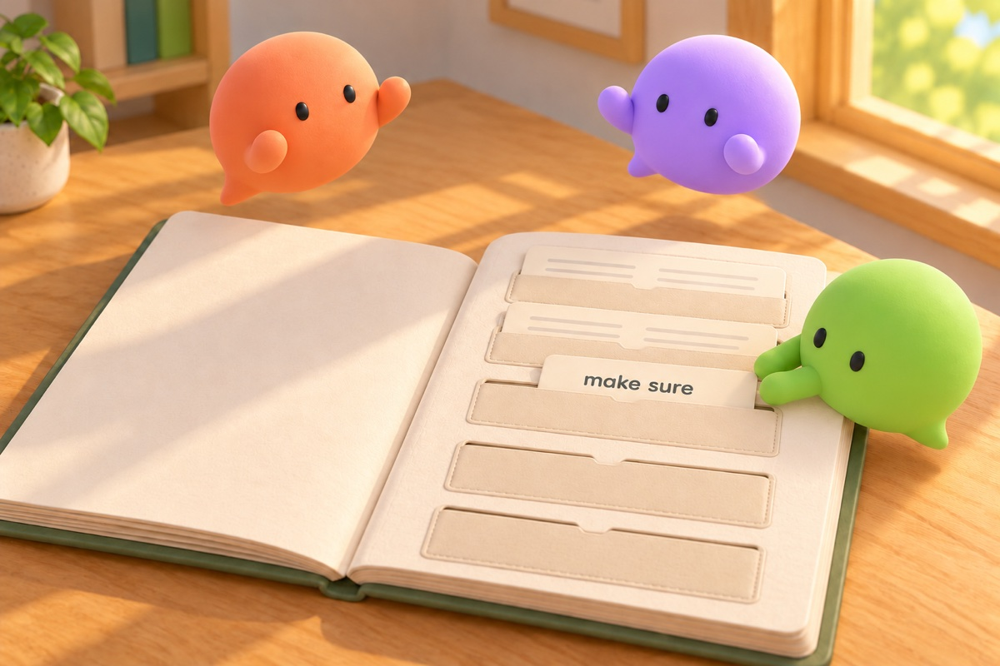
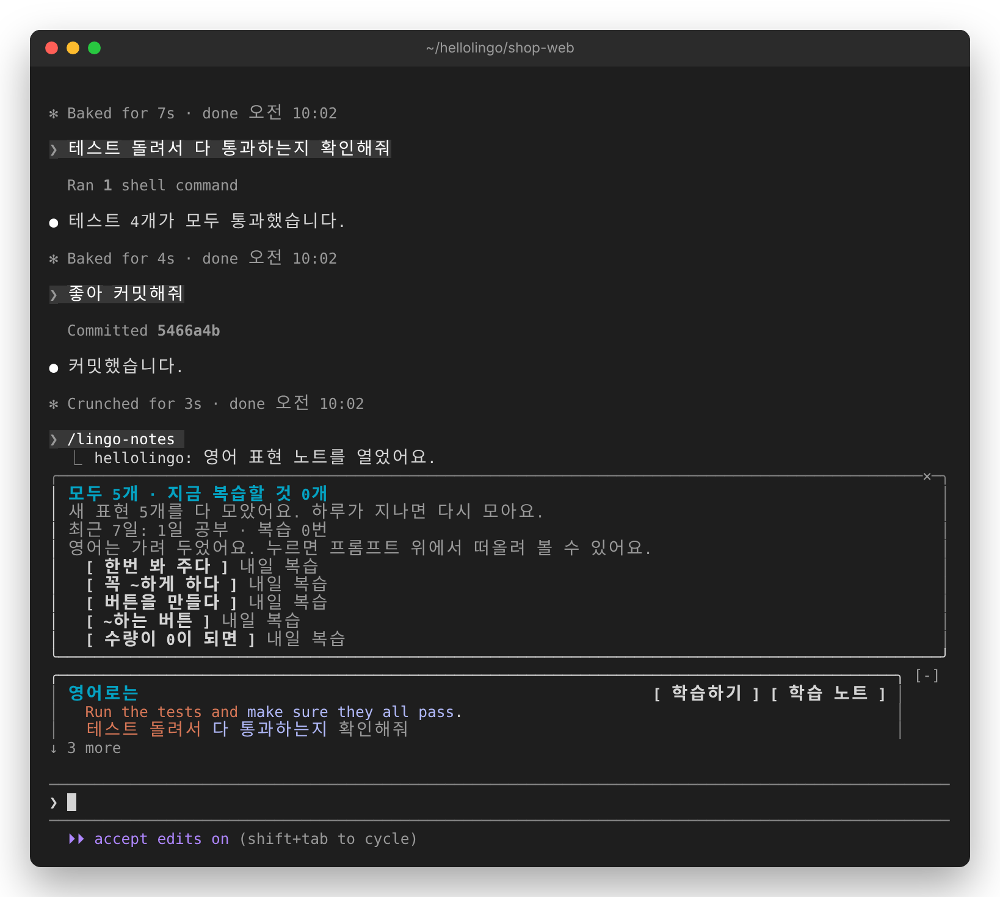

# 4. 모으기. 표현 하나를 노트에



카드 맨 아래 `•` 줄이 그 카드의 핵심 표현입니다. 다른 일을 시킬 때도 또 쓸 만한 말 하나를 골라 노트에 모읍니다. 단추를 누르지 않아도 저절로 모입니다.

유진의 오전에는 이런 것이 모였습니다.

- Create a button. 첫 카드의 핵심 표현입니다.
- a button to ~. [3장](03-study.md)의 학습하기에서 연습한 배울 점입니다.
- when the quantity becomes 0. 둘째 카드의 핵심 표현입니다.

## 노트 보기

입력창에 입력합니다.

```
/lingo-notes
```

모은 표현의 한국어 뜻과, 각각 언제 다시 나오는지 보입니다. 영어는 가려 두었습니다. 다시 읽기보다 떠올리기가 오래 남기 때문입니다. 표현을 누르면 입력창 위에서 떠올려 볼 수 있습니다.



- 맨 위에는 최근 7일 동안 공부한 날과 복습한 수가 나옵니다. 이 기록은 내 컴퓨터에만 남습니다.
- 닫으려면 입력창이 빈 채로 `Esc`를 누릅니다. 오른쪽 위 `✕`를 눌러도 됩니다.
- 카드 위쪽의 `학습 노트` 단추로도 노트를 볼 수 있습니다. [7장](07-notes.md)에서 다룹니다.

## 하루 5개까지만

위 화면 맨 위에 "새 표현 5개를 다 모았어요."가 보입니다. 유진은 아침 일찍 다른 일을 하면서 표현 2개를 모았습니다. 그래서 이번 오전에 5개가 찼고, 그다음 카드의 "look too small"은 모으지 않았습니다.

학습하기로 연습한 배울 점은 5개가 차 있어도 담깁니다. 대신 그날 모은 수에 들어갑니다.

일부러 그렇게 만들었습니다. 많이 모으는 것보다 잊지 않는 것이 중요하기 때문입니다. 모으지 않는 동안에도 카드는 그대로 나옵니다.

같은 표현은 두 번 모으지 않습니다. 오전 마지막 카드의 "make sure"는 아침에 이미 모은 표현입니다.

다음: [5. 떠올리기](05-recall.md)
