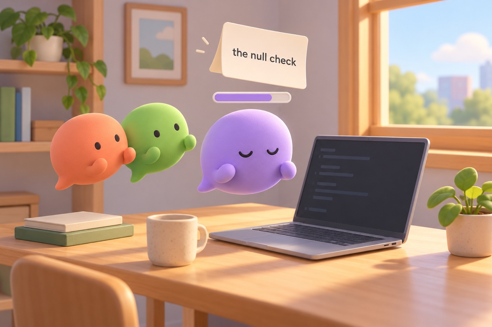
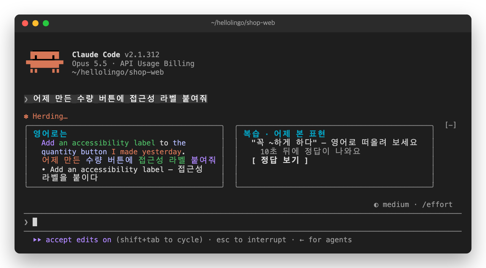
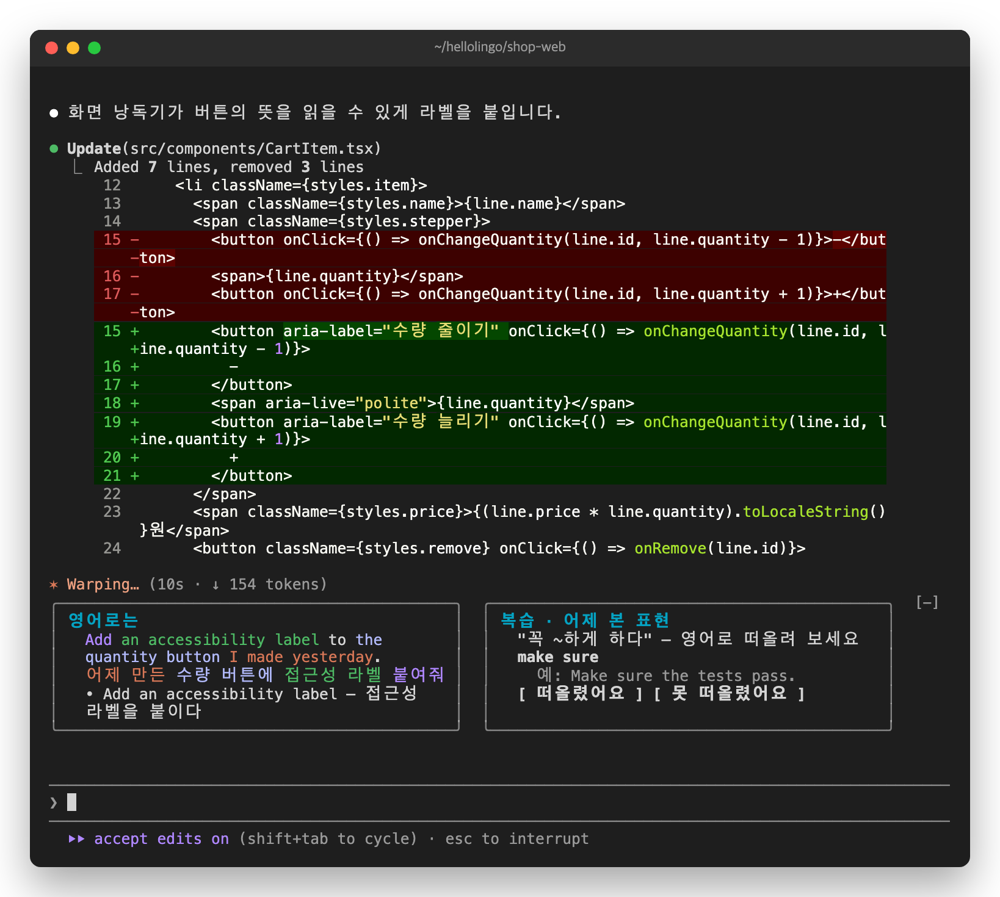
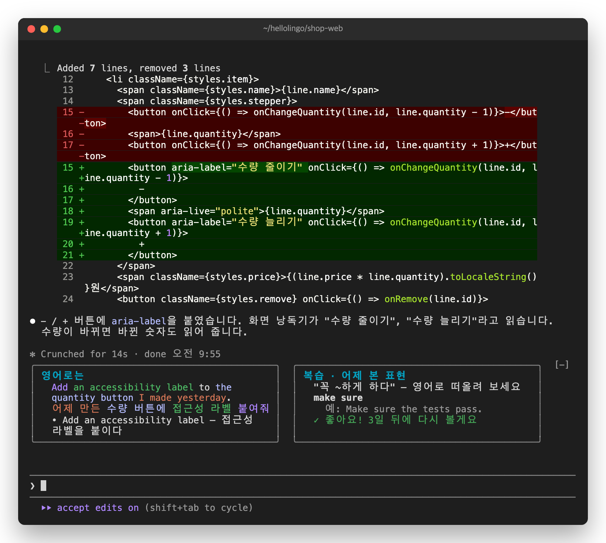

# 4. 떠올리기. 다음 날 퀴즈로



다음 날 아침입니다. 유진이 어제 만든 버튼에 일을 더 시킵니다.

```
어제 만든 수량 버튼에 접근성 라벨 붙여줘
```

카드 옆에 퀴즈가 나옵니다. 어제 모은 표현 하나의 한국어 뜻이 나옵니다.



## 푸는 법

1. 따옴표 안의 한국어 뜻을 봅니다.
2. 영어를 **머릿속으로** 떠올립니다. 쓰지 않아도 됩니다.
3. 10초를 기다리면 정답과 예문이 나옵니다. 바로 보려면 `정답 보기`를 마우스로 누릅니다.

   

4. 떠올렸으면 `떠올렸어요`를, 못 떠올렸으면 `못 떠올렸어요`를 누릅니다.

   

키보드로도 됩니다. 그러려면 먼저 키가 퀴즈로 가게 합니다. 둘 중 하나를 합니다.

- 퀴즈를 마우스로 한 번 누릅니다.
- `ctrl+x`를 누른 다음 `tab`을 누릅니다.

| 키 | 하는 일 |
| --- | --- |
| `r` | 정답 보기 |
| `o` | 떠올렸어요 |
| `x` | 못 떠올렸어요 |

## 다시 나오는 날

누른 답에 따라 다음에 나오는 날이 정해집니다.

| 누른 것 | 다음에 나오는 날 |
| --- | --- |
| 처음 떠올렸어요 | 3일 뒤 |
| 또 떠올렸어요 | 7일 뒤, 그다음은 14일 뒤, 30일 뒤 |
| 못 떠올렸어요 | 다음 날 (처음부터 다시) |

못 떠올려도 괜찮습니다. 떠올리려고 애쓴 것만으로도 기억에 도움이 됩니다. 답을 누르지 않고 넘어가도 됩니다. 정답을 본 표현은 다음 날 다시 나옵니다. 정답이 나오기 전에 넘어간 표현은 다른 표현을 먼저 낸 뒤에 다시 나옵니다.

복습할 표현이 남아 있으면, 프롬프트를 보낼 때마다 퀴즈가 하나씩 나옵니다. 첫날에는 복습할 표현이 없어서 나오지 않습니다.

다음: [5. 영어로 써 보기](05-english.md)
