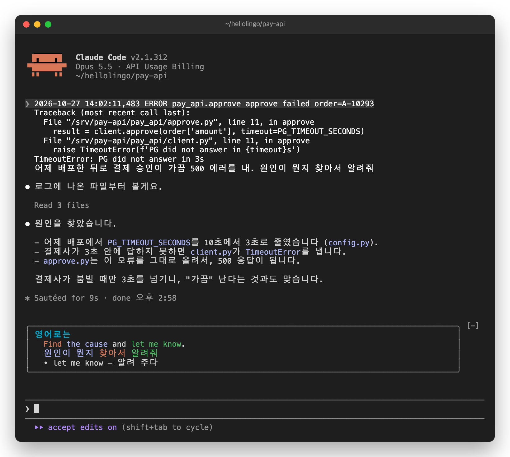
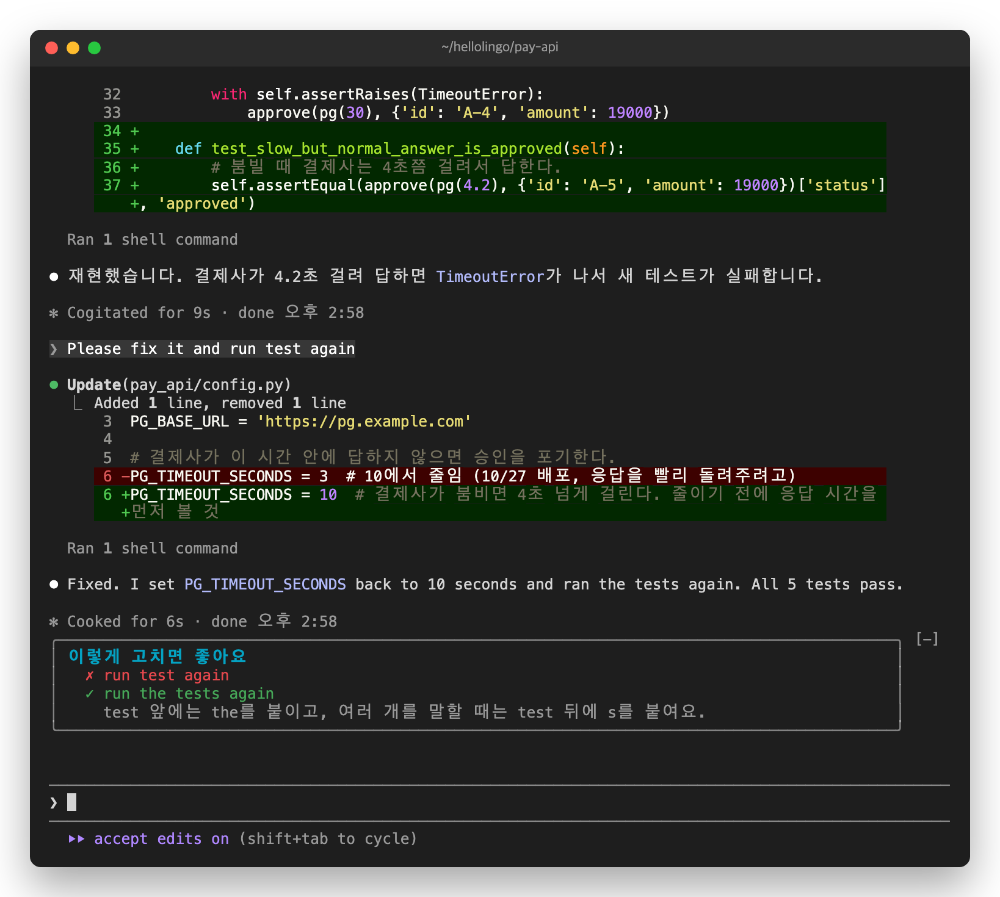
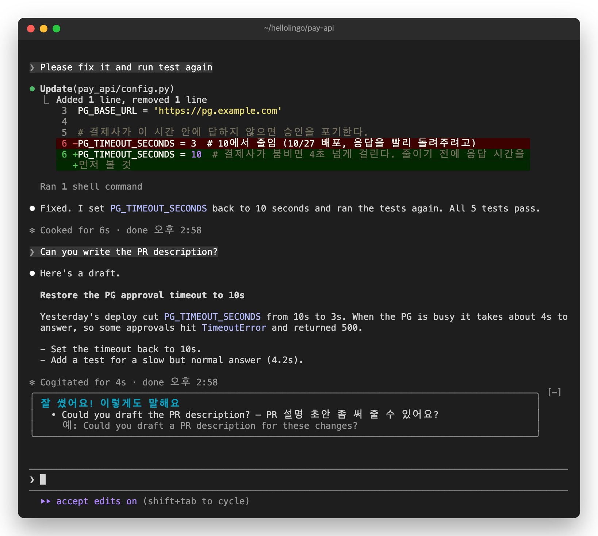

# 5. 영어로 써 보기


도윤은 결제 승인 API를 만드는 개발자입니다. 어제 배포한 뒤로 결제 승인이 가끔 실패합니다.

## 로그를 붙여 넣어도 내 문장만

도윤은 오류 로그를 붙여 넣고, 그 뒤에 부탁을 씁니다.

![입력창에 "[Pasted text #1 +7 lines]" 뒤로 "어제 배포한 뒤로 결제 승인이 가끔 500 에러를 내. 원인이 뭔지 찾아서 알려줘"가 적혀 있습니다.](images/english-0-paste.png)

카드는 붙여 넣은 로그를 빼고 옮깁니다. 부탁이 두 문장이라, 주된 부탁인 "원인이 뭔지 찾아서 알려줘"만 옮겼습니다.



## 영어로 쓰면 고쳐 줍니다

Claude가 원인을 찾고, 문제를 테스트로 재현했습니다. 이번에는 도윤이 영어로 써 봅니다.

```
Please fix it and run test again
```

틀린 곳이 있으면 고쳐 줍니다. `✗`는 틀린 곳, `✓`는 고친 곳, 그 아래는 이유입니다.



## 틀린 곳이 없으면

도윤은 고친 내용을 동료에게 검토받으려고, 설명 글(PR 설명)을 부탁합니다.

```
Can you write the PR description?
```

틀린 곳이 없으면 더 자연스러운 말을 하나 알려 줍니다. 이 표현도 노트에 모입니다.



Claude는 영어로 쓴 부탁에도 평소처럼 일합니다. 카드는 Claude의 답을 바꾸지 않습니다.

다음: [6. 노트와 밀린 복습](06-notes.md)
