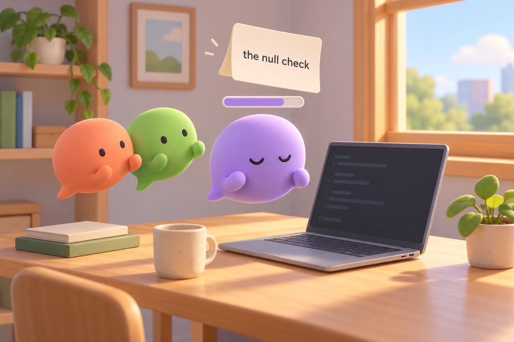
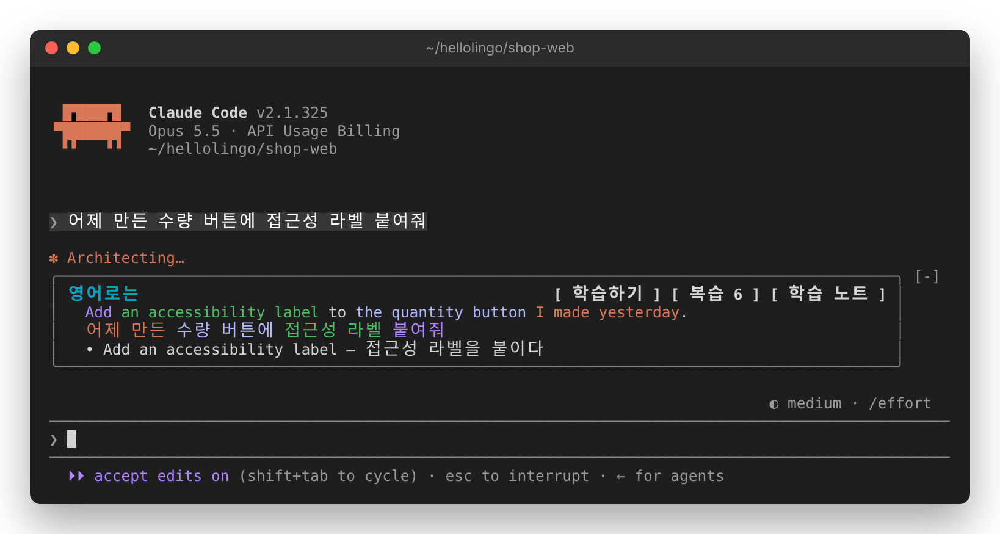
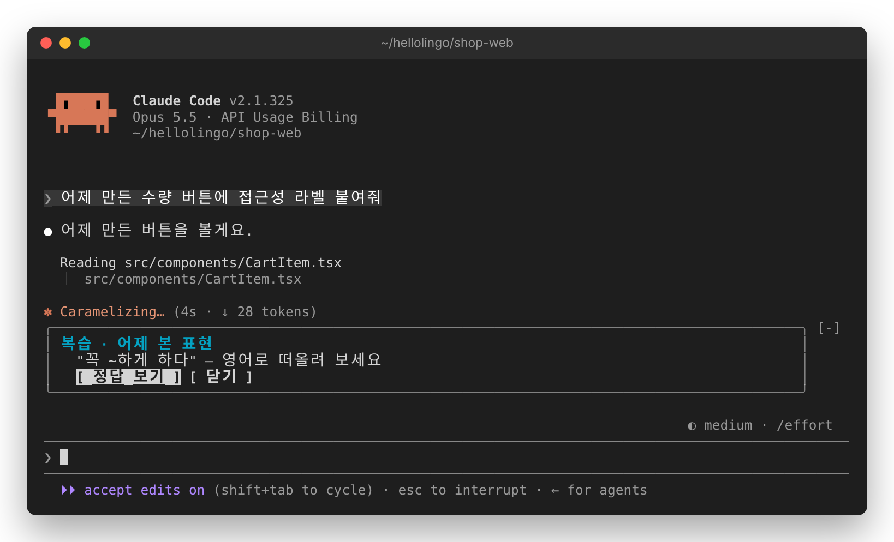
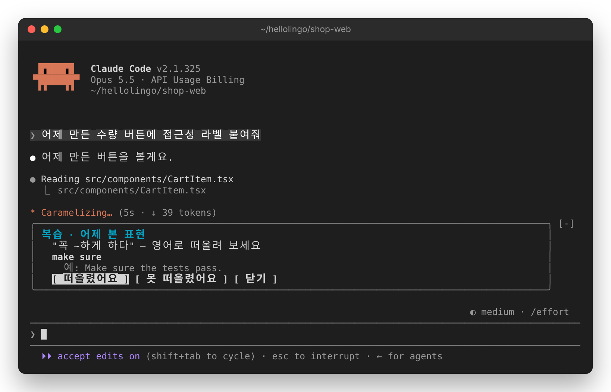
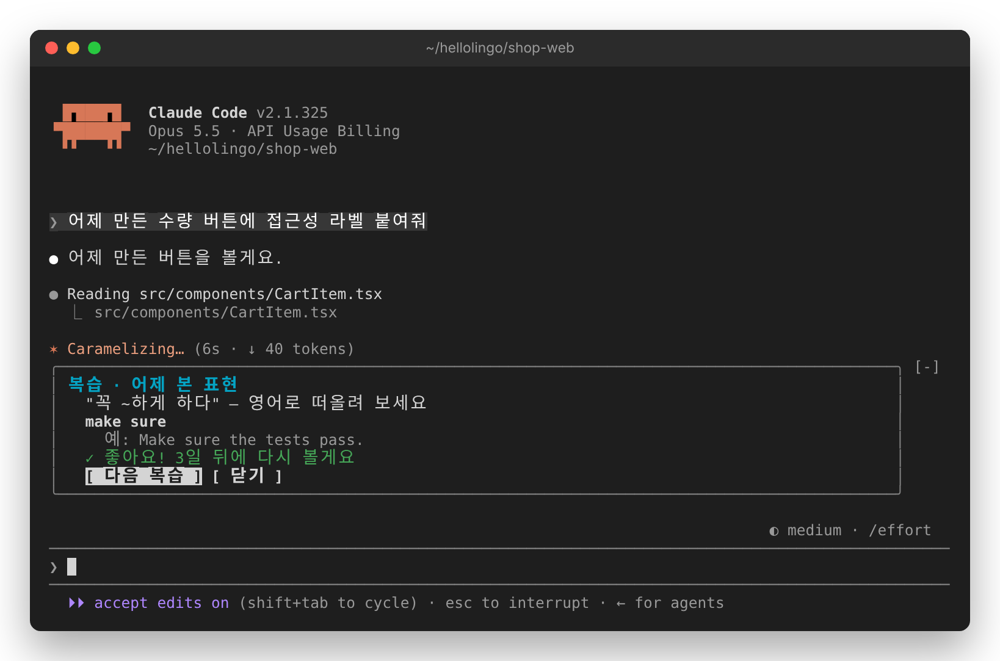
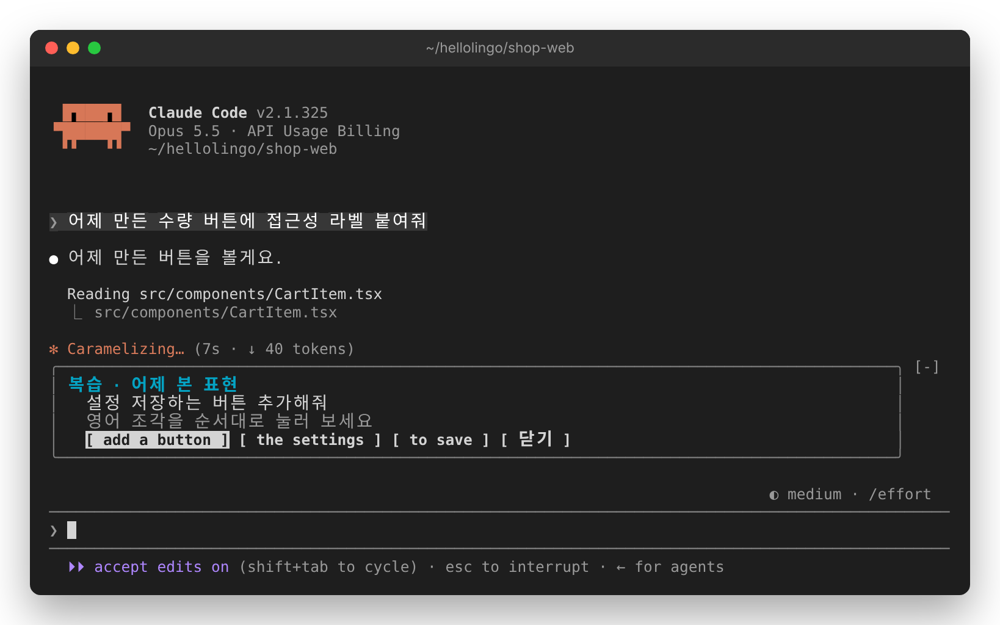
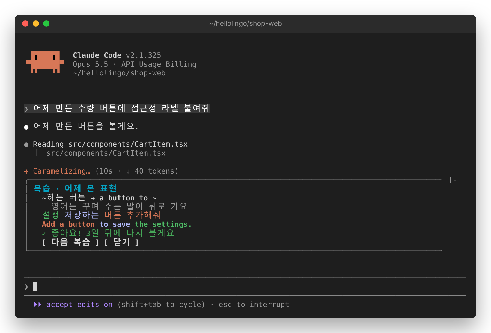

# 5. 떠올리기. 다음 날 복습으로



다음 날 아침입니다. 유진이 어제 만든 버튼에 일을 더 시킵니다.

```
어제 만든 수량 버튼에 접근성 라벨 붙여줘
```

카드 위쪽에 `복습 6`이 생겼습니다. 어제 모은 표현 가운데 6개를 복습할 때가 되었다는 뜻입니다. 퀴즈는 저절로 나오지 않습니다. Claude가 일하는 동안 시간이 나면 누릅니다.



## 핵심 표현 떠올리기

`복습 6`을 누르면 카드 자리에 복습 칸이 열립니다. 어제 모은 표현 하나의 한국어 뜻이 나옵니다.



1. 따옴표 안의 한국어 뜻을 봅니다.
2. 영어를 **머릿속으로** 떠올립니다. 쓰지 않아도 됩니다.
3. 다 떠올렸으면 `정답 보기`를 누릅니다. 정답과 예문이 나옵니다. 서두르지 않아도 됩니다. 정답은 누를 때 나옵니다.

   

4. 떠올렸으면 `떠올렸어요`를, 못 떠올렸으면 `못 떠올렸어요`를 누릅니다.

   

`다음 복습`을 누르면 다음 표현이 나옵니다. 한 번에 다 하지 않아도 됩니다. 언제든 `닫기`를 누르고, 나중에 다시 `복습`을 누르면 됩니다.

## 어제 연습한 틀 떠올리기

어제 [학습하기](03-study.md)에서 연습한 배울 점도 복습에 나옵니다. 이번에는 처음 보는 문장으로, 색 없이 조각을 맞춥니다.



다 맞추면 배울 점이 다시 보이고, 다음에 언제 볼지 나옵니다. 조각을 맞췄으면 떠올린 것입니다. 따로 `떠올렸어요`를 누르지 않습니다.



## 키로 하기

먼저 키가 카드로 가게 합니다. 카드를 마우스로 한 번 누르거나, `ctrl+x`를 누른 다음 `tab`을 누릅니다.

| 키 | 하는 일 |
| --- | --- |
| `v` | 복습 열기 |
| `r` | 정답 보기 |
| `o` | 떠올렸어요 |
| `x` | 못 떠올렸어요 |
| `1`, `2`, `3` | 조각 고르기. 남은 조각을 왼쪽부터 셉니다. |
| `n` | 다음 복습 |
| `q` | 닫기 |

## 다시 나오는 날

답에 따라 다음에 나오는 날이 정해집니다.

| 답 | 다음에 나오는 날 |
| --- | --- |
| 처음 떠올렸어요 | 3일 뒤 |
| 또 떠올렸어요 | 7일 뒤, 그다음은 14일 뒤, 30일 뒤 |
| 못 떠올렸어요 | 다음 날 (처음부터 다시) |

- 못 떠올려도 괜찮습니다. 떠올리려고 애쓴 것만으로도 기억에 도움이 됩니다.
- 정답을 본 뒤 답하지 않고 닫으면, 그 표현은 다음 날 다시 나옵니다. 간격은 그대로입니다.
- 첫날에는 복습할 표현이 없어서 `복습` 단추가 없습니다.

다음: [6. 영어로 써 보기](06-english.md)
