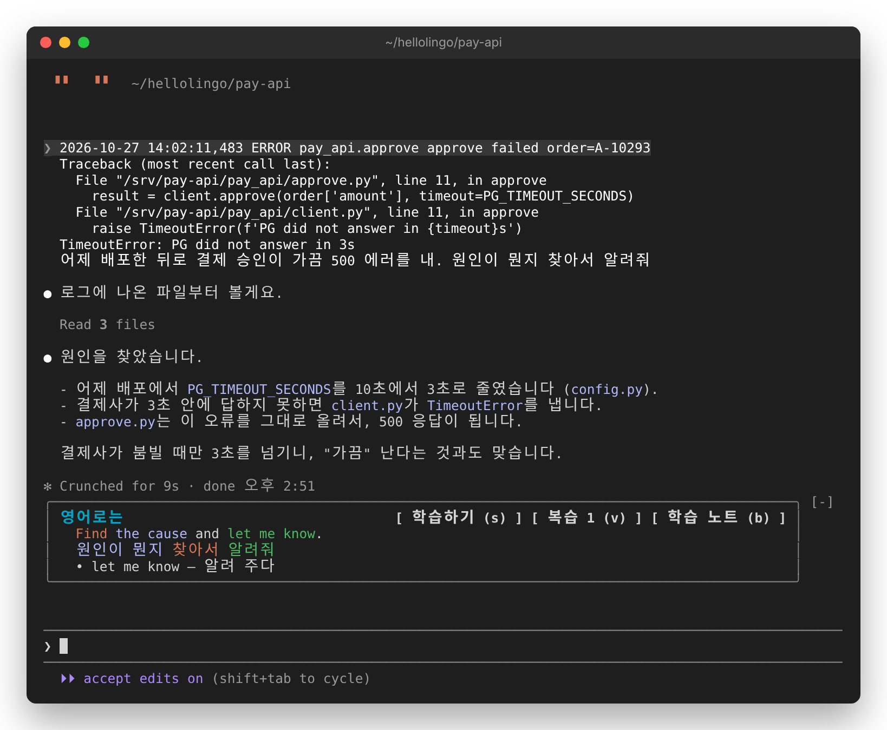
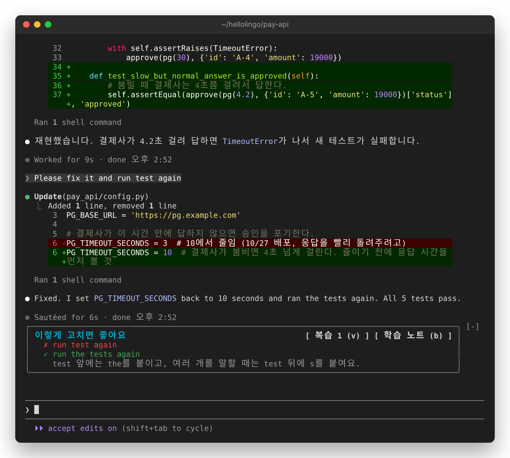
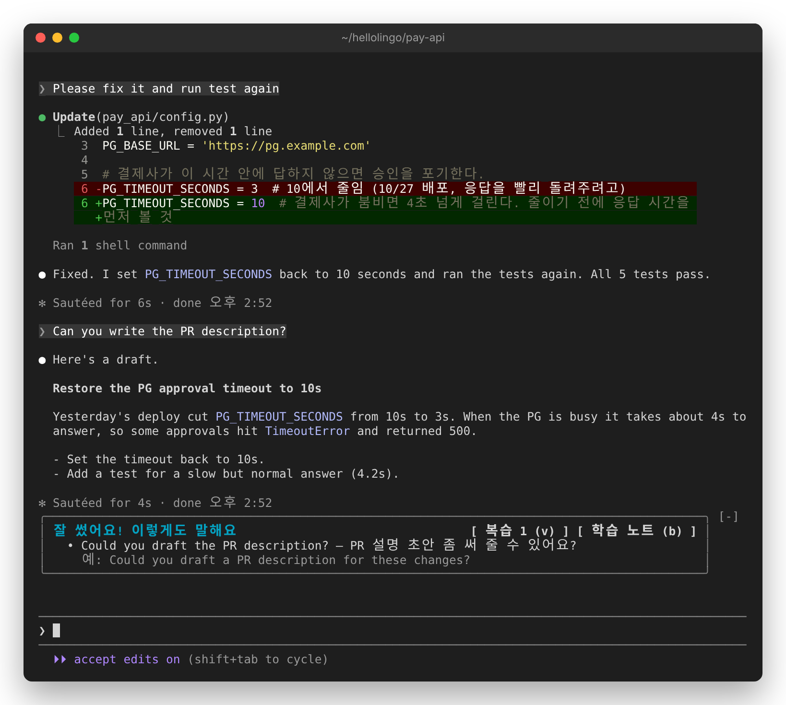
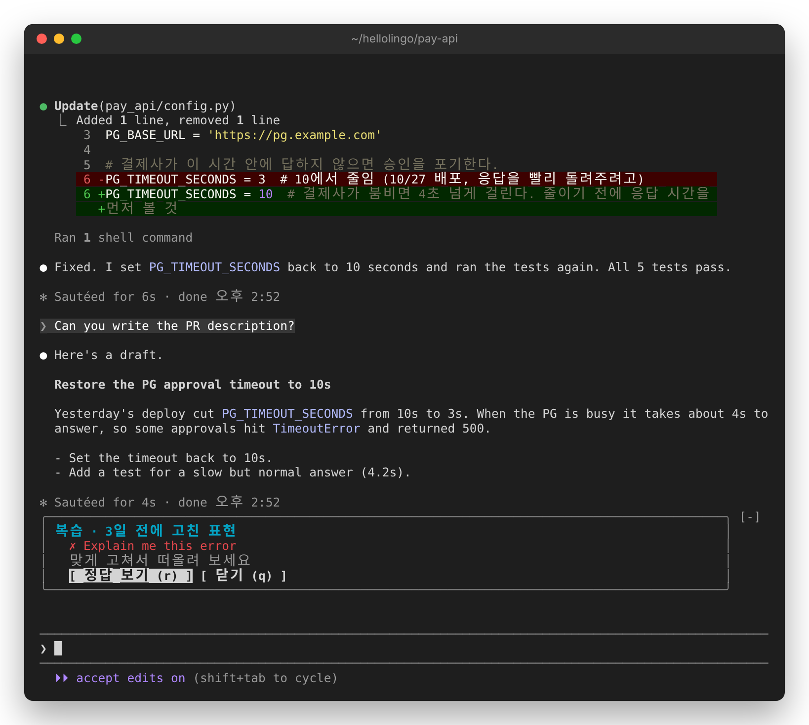
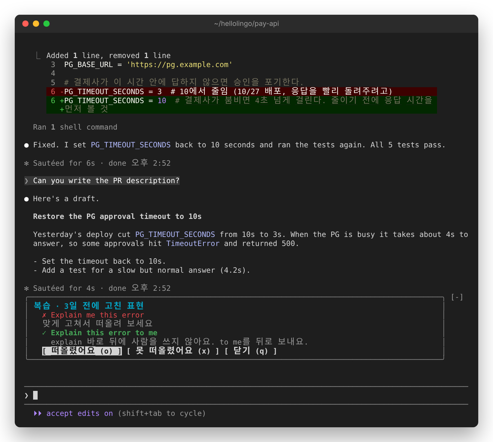

# 6. 영어로 써 보기


도윤은 결제 승인 API를 만드는 개발자입니다. 어제 배포한 뒤로 결제 승인이 가끔 실패합니다.

## 로그를 붙여 넣어도 내 문장만

도윤은 오류 로그를 붙여 넣고, 그 뒤에 부탁을 씁니다.

![입력창에 "[Pasted text #1 +7 lines]" 뒤로 "어제 배포한 뒤로 결제 승인이 가끔 500 에러를 내. 원인이 뭔지 찾아서 알려줘"가 적혀 있습니다.](images/english-0-paste.png)

카드는 붙여 넣은 로그를 빼고 옮깁니다. 부탁이 두 문장이라, 주된 부탁인 "원인이 뭔지 찾아서 알려줘"만 옮겼습니다.



## 영어로 쓰면 고쳐 줍니다

Claude가 원인을 찾고, 문제를 테스트로 재현했습니다. 이번에는 도윤이 영어로 써 봅니다.

```
Please fix it and run test again
```

틀린 곳이 있으면 고쳐 줍니다. `✗`는 틀린 곳, `✓`는 고친 곳, 그 아래는 이유입니다.



고친 곳 가운데 맨 위의 하나는 노트에 모입니다. 내가 실제로 틀린 곳이라, 다시 떠올려 볼 만한 것이기 때문입니다.

- 문장 전체를 고쳐 쓴 긴 고침(60자 넘게)은 모으지 않습니다. 떠올려 볼 크기가 아니기 때문입니다.
- 새 고침도 하루 5개, 밀린 복습 10개의 한도를 따릅니다.
- 이미 모은 고침과 같은 실수를 또 하면, 그 고침을 처음부터 다시 봅니다.

## 틀린 곳이 없으면

도윤은 고친 내용을 동료에게 검토받으려고, 설명 글(PR 설명)을 부탁합니다.

```
Can you write the PR description?
```

틀린 곳이 없으면 더 자연스러운 말을 하나 알려 줍니다. 이 표현도 노트에 모입니다.



## 고친 곳 다시 떠올리기

도윤은 지난주에 "Explain me this error"라고 썼다가 고침을 받았습니다. 그 고침이 복습할 때가 되어, 카드 위쪽에 `복습 1`이 있습니다. 눌러 봅니다.

내가 썼던 틀린 문장이 나옵니다. 어떻게 고치면 맞는지 머릿속으로 떠올립니다.



`정답 보기`를 누르면 고친 말과 까닭이 나옵니다. 떠올렸는지에 따라 `떠올렸어요`나 `못 떠올렸어요`를 누릅니다.



Claude는 영어로 쓴 부탁에도 평소처럼 일합니다. 카드는 Claude의 답을 바꾸지 않습니다.

다음: [7. 노트와 밀린 복습](07-notes.md)
