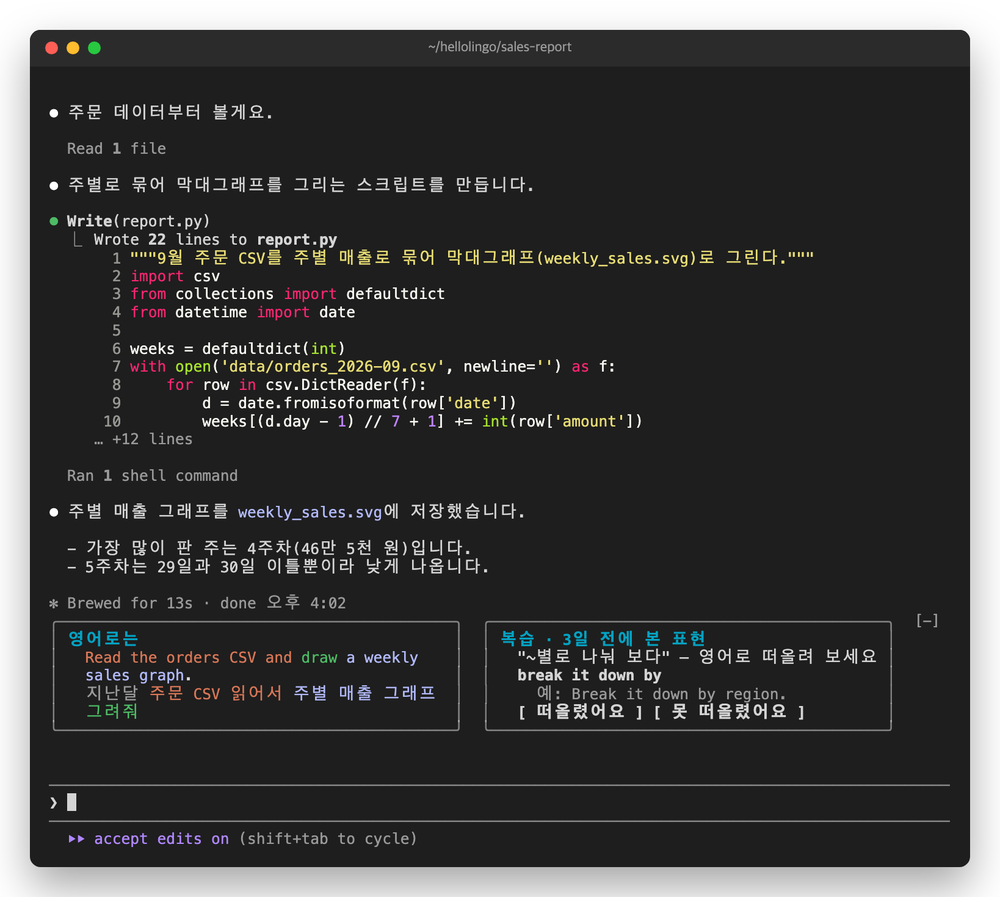
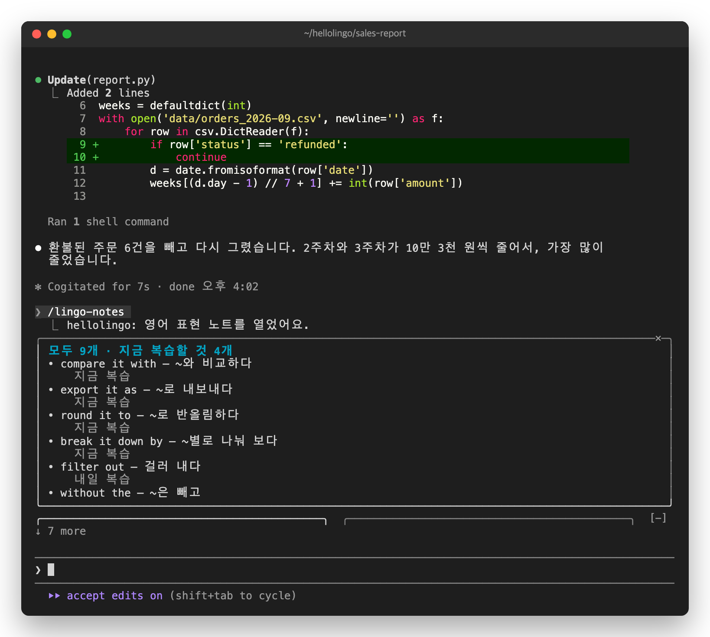
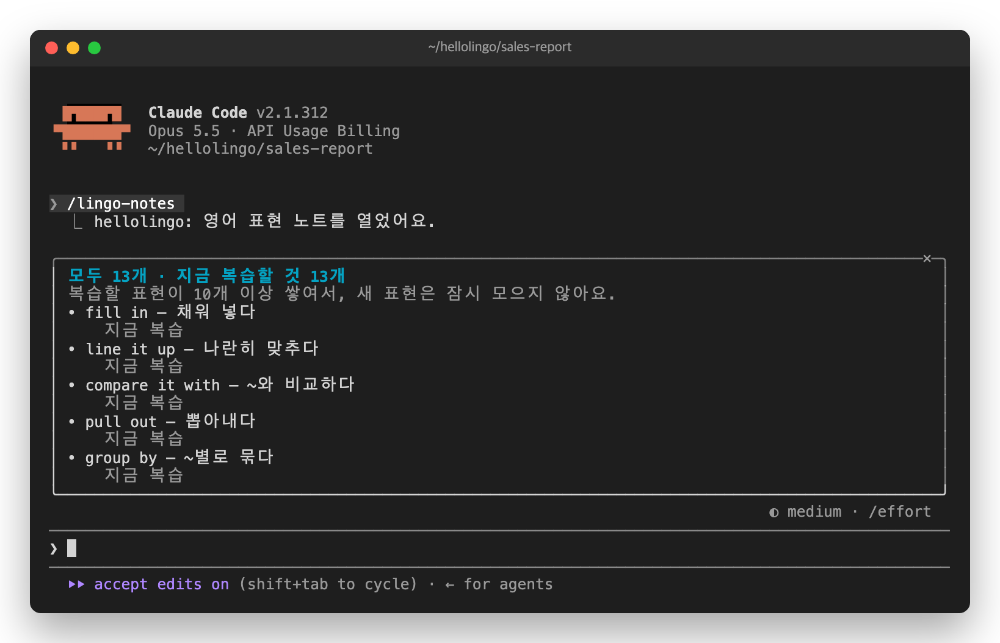

# 6. 노트와 밀린 복습


하늘은 데이터 분석가입니다. 코드는 잘 모르지만, Claude에게 CSV로 그래프를 만들게 합니다. hellolingo를 쓴 지 일주일이 됐습니다.

## 일하는 동안 퀴즈

```
지난달 주문 CSV 읽어서 주별 매출 그래프 그려줘
```

Claude가 그래프를 그리는 동안, 옆에 지난 표현이 퀴즈로 나옵니다. 어차피 기다리는 시간에 하나씩 떠올립니다.



## 노트 보기

```
/lingo-notes
```

일주일 동안 모은 표현이, 다시 볼 날이 가까운 것부터 나옵니다. "지금 복습"은 오늘 퀴즈로 나올 표현입니다. 패널에 다 들어가지 않으면 패널을 내려서 봅니다. `ctrl+x`를 누른 다음 `tab`을 눌러 패널로 옮겨 가고, 아래 방향키를 누릅니다.



## 복습이 밀린 날

며칠 쉬고 돌아오면 복습할 표현이 쌓입니다. 10개 이상 쌓이면 새 표현을 잠시 모으지 않습니다. 퀴즈를 풀어서 10개 아래로 줄면 다시 모읍니다.



쌓였다고 한꺼번에 풀 필요는 없습니다. 복습할 표현이 남아 있는 동안, 프롬프트를 보낼 때마다 하나씩 나옵니다. 모으지 않는 동안에도 카드는 그대로 나옵니다.

다음: [7. 개발자가 아니어도](07-everyone.md)
