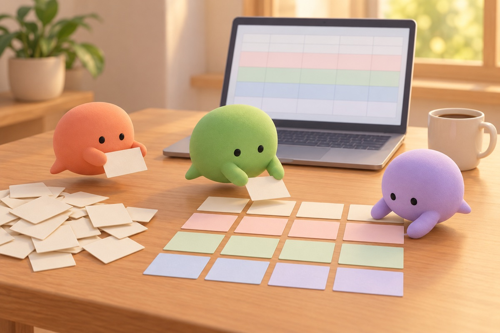
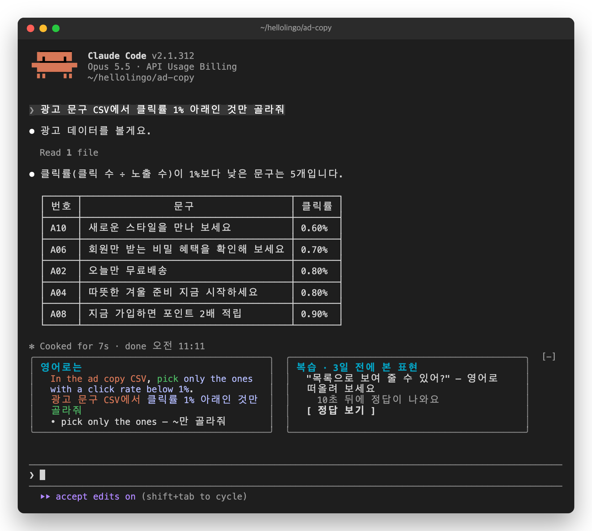
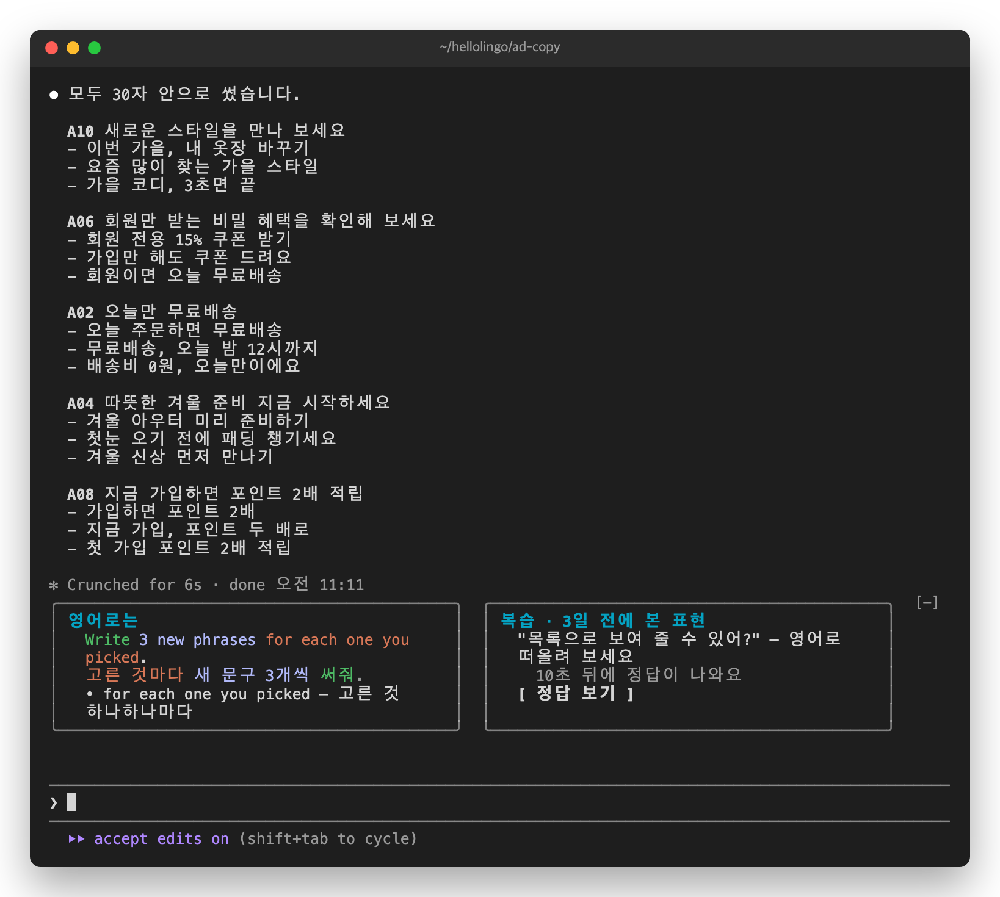
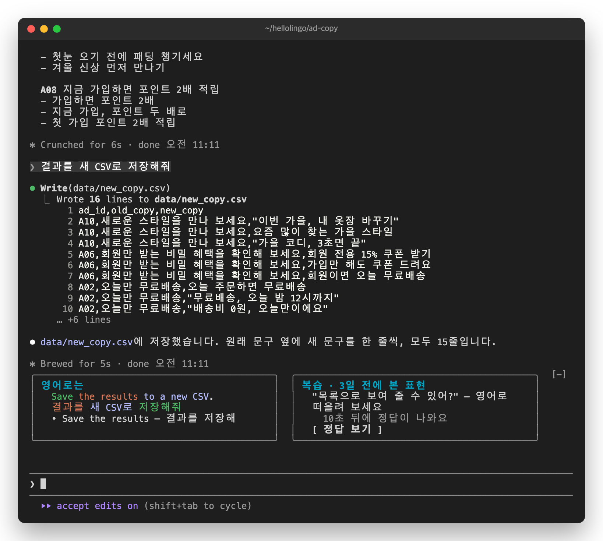

# 7. 개발자가 아니어도



민은 혼자 온라인 옷 가게의 광고를 맡은 마케터입니다. 코드를 쓰지 않고, Claude에게 광고 성과 정리를 맡깁니다.

## 데이터 고르기

```
광고 문구 CSV에서 클릭률 1% 아래인 것만 골라줘
```

카드는 개발 일이 아니어도 똑같이 나옵니다. "pick only the ones"(~만 골라줘)처럼, 다른 일에도 쓸 말을 모읍니다.



## 문구 쓰기

```
고른 것마다 새 문구 3개씩 써줘. 30자 넘지 않게
```

두 문장 중 주된 부탁인 "고른 것마다 새 문구 3개씩 써줘."만 옮겼습니다.



## 저장하기

```
결과를 새 CSV로 저장해줘
```



개발자가 아니어도, Claude에게 일을 시키는 문장은 매일 씁니다. 그 문장이 그대로 영어 공부 재료가 됩니다.

다음: [8. 끄기, 업데이트, 문제 해결](08-troubleshooting.md)
