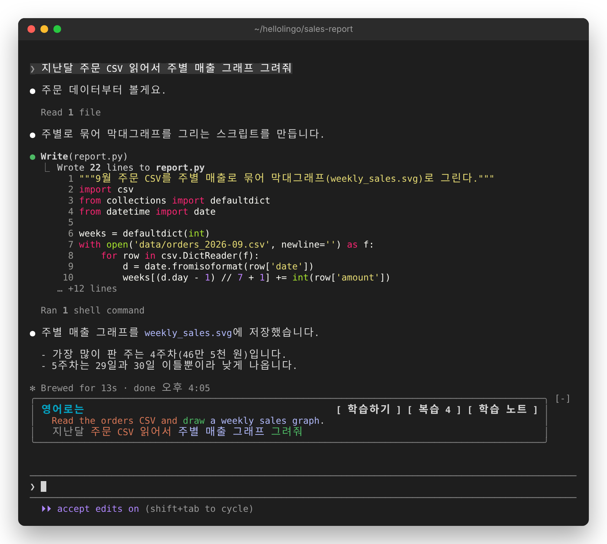
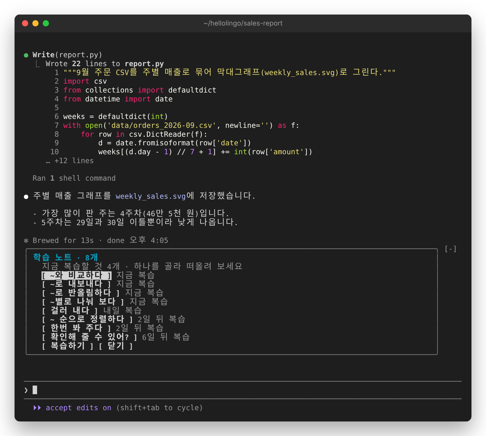
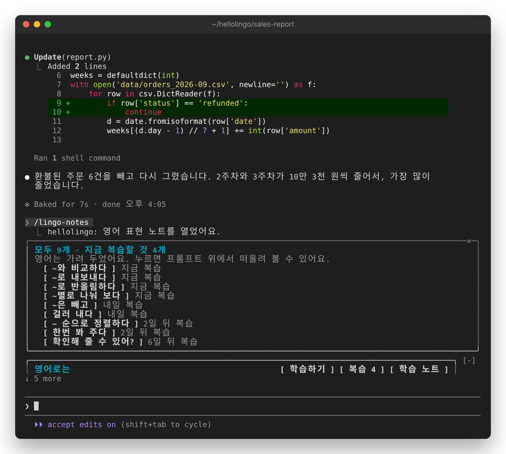
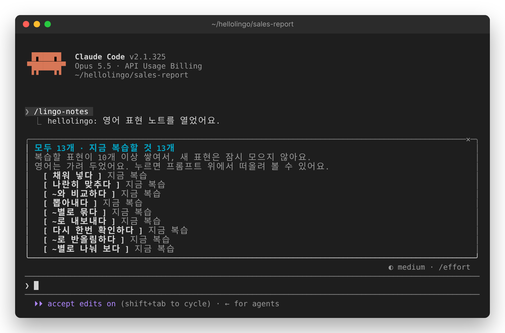

# 7. 노트와 밀린 복습


하늘은 데이터 분석가입니다. 코드는 잘 모르지만, Claude에게 CSV로 그래프를 만들게 합니다. hellolingo를 쓴 지 일주일이 됐습니다.

## 일하는 동안 복습

```
지난달 주문 CSV 읽어서 주별 매출 그래프 그려줘
```

카드 위쪽에 `복습 4`가 있습니다. 지난 표현 4개를 복습할 때가 되었습니다. Claude가 그래프를 그리는 동안, 어차피 기다리는 시간에 하나씩 떠올립니다.



## 학습 노트에서 골라 떠올리기

`학습 노트`를 누르면 카드 자리에 노트 목록이 열립니다.



- 영어는 가려 두었습니다. 무엇을 누르든 떠올리기가 됩니다.
- 복습할 때가 된 표현이 맨 위에 있습니다. 그다음은 아직 덜 익힌 표현입니다. 위에서부터 고르면 지금 필요한 표현을 고르게 됩니다.
- 숫자 키 `1`부터 `8`로도 고릅니다. 위에서부터 셉니다.

복습할 때가 아닌 표현도 골라서 떠올릴 수 있습니다. 이것은 연습입니다.

| 연습한 결과 | 다음에 나오는 날 |
| --- | --- |
| 떠올렸어요 | 그대로 |
| 못 떠올렸어요 | 내일로 당깁니다 |

아는 표현만 골라도 다음 복습이 늦어지지 않습니다. 모르는 표현을 고르면 일찍 다시 만납니다.

## 노트 전체 보기

```
/lingo-notes
```

일주일 동안 모은 표현이 패널에 나옵니다. "지금 복습"은 오늘 복습할 표현입니다. 표현을 누르면 입력창 위에서 떠올려 볼 수 있습니다. 패널에 다 들어가지 않으면 패널을 내려서 봅니다. `ctrl+x`를 누른 다음 `tab`을 눌러 패널로 옮겨 가고, 아래 방향키를 누릅니다.



## 복습이 밀린 날

며칠 쉬고 돌아오면 복습할 표현이 쌓입니다. 10개 이상 쌓이면 새 표현을 잠시 모으지 않습니다. 복습해서 10개 아래로 줄면 다시 모읍니다.



쌓였다고 한꺼번에 풀 필요는 없습니다. `복습`을 누를 때마다 하나씩, 시간 날 때 풀면 됩니다. 모으지 않는 동안에도 카드는 그대로 나옵니다.

다음: [8. 개발자가 아니어도](08-everyone.md)
