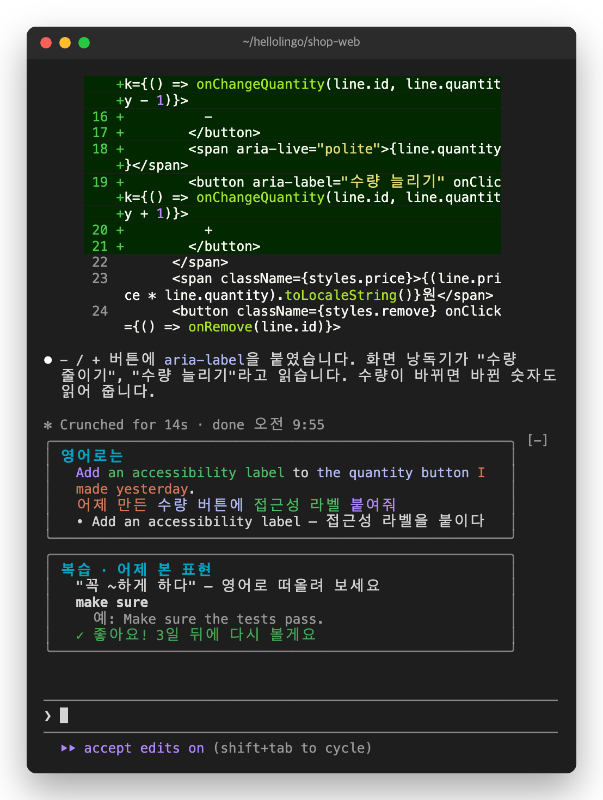

# 8. 끄기, 업데이트, 문제 해결

## 창이 좁을 때

창 너비가 70칸보다 좁으면 카드와 퀴즈가 위아래로 쌓입니다.



창 높이가 낮으면 아래쪽이 잘리고 `↓ 3 more`처럼 나옵니다. 그때는 창을 키웁니다.

## 끄기, 업데이트, 지우기

터미널에서 실행합니다.

잠시 끄기:

```bash
claude plugin disable hellolingo@hellolingo
```

다시 켜기:

```bash
claude plugin enable hellolingo@hellolingo
```

새 버전으로 바꾸기:

```bash
claude plugin update hellolingo@hellolingo
```

지우기:

```bash
claude plugin uninstall hellolingo@hellolingo
```

지워도 노트는 남습니다. 노트까지 지우려면 먼저 Claude Code를 모두 닫습니다. 그다음 `~/.claude/plugins/store/` 폴더에서 `hellolingo_`로 시작하는 파일을 지웁니다.

## 이럴 땐 이렇게

**카드가 안 나와요.**

- 프롬프트가 10자보다 짧으면 카드를 만들지 않습니다.
- `/`로 시작하는 명령이나 자동 알림 같은 메시지에도 카드를 만들지 않습니다.
- 설치한 뒤 새 세션을 열었는지 봅니다.
- `claude --version`으로 v2.1.311 이상인지 봅니다.
- VS Code 확장에서는 보이지 않습니다. 터미널이나 데스크톱 앱에서 씁니다.
- 로그인이 만료됐으면 카드를 만들 수 없습니다. `/login`으로 다시 로그인합니다.

**퀴즈가 안 나와요.**

- 첫날에는 복습할 표현이 없습니다. 표현을 모은 다음 날부터 나옵니다.

**키를 눌러도 반응이 없어요.**

- 퀴즈를 먼저 마우스로 한 번 누릅니다.
- 또는 `ctrl+x`를 누른 다음 `tab`을 누릅니다.

**노트 패널이 안 닫혀요.**

- 입력창에 글자가 있으면 `Esc`가 글자 쪽으로 갑니다. 입력창을 비우고 `Esc`를 누르거나, `✕`를 누릅니다.

**새 표현이 노트에 안 들어가요.**

- 새 표현은 하루 5개까지만 모읍니다. [3장](03-collect.md)을 봅니다.
- 복습할 표현이 10개 이상 쌓이면 잠시 모으지 않습니다. [6장](06-notes.md)을 봅니다.

**카드의 한국어가 내 프롬프트 일부만 나와요.**

- 프롬프트가 길면 주된 부탁 한 문장만 옮깁니다. 붙여 넣은 로그나 코드는 빼고 옮깁니다. [5장](05-english.md)을 봅니다.

[가이드 처음으로](README.md)
