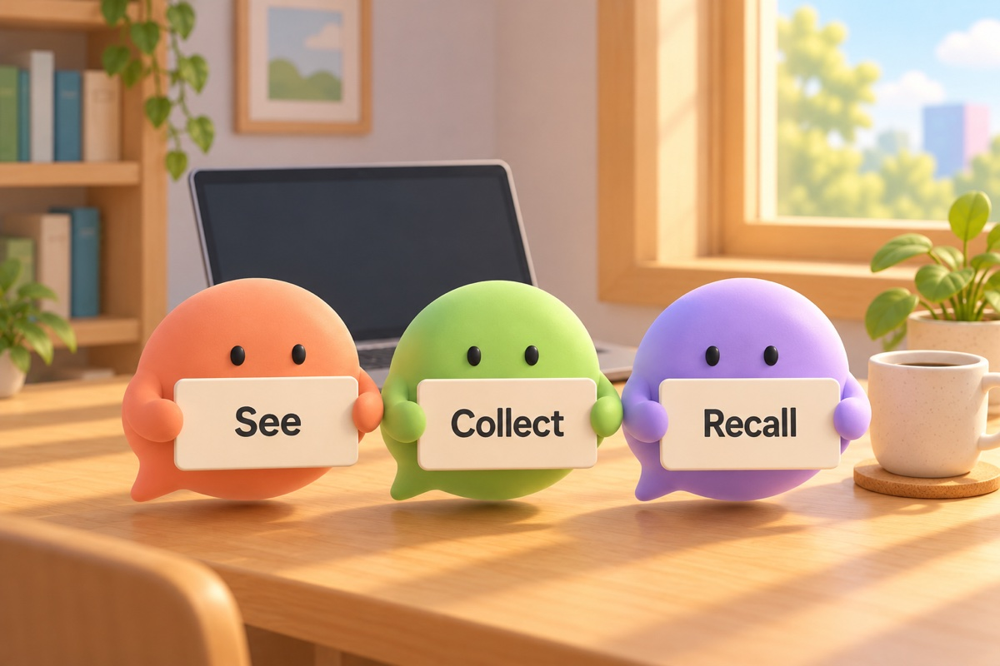

# hellolingo 가이드

hellolingo는 Claude와 일하는 동안 영어가 조금씩 늘게 돕는 Claude Code 플러그인입니다. 따로 공부할 시간을 내지 않아도 됩니다. 평소처럼 한국어로 일을 시키면 됩니다.

지금은 영어를 배웁니다. 일본어, 중국어, 비즈니스 용어도 차례로 넣을 계획입니다. 자세한 계획은 [로드맵](../../ROADMAP.md)에 있습니다.

## 배우는 길은 세 단계입니다

| 단계 | 하는 일 | 돕는 친구 |
| --- | --- | --- |
| 보기 | 내 문장이 영어로 어떻게 되는지 봅니다. | 보리 (주황) |
| 모으기 | 다시 쓸 표현 하나를 노트에 모읍니다. | 모아 (초록) |
| 떠올리기 | 다음 날, Claude가 일하는 동안 퀴즈로 떠올립니다. | 올리 (보라) |

보리, 모아, 올리는 이 가이드의 그림에 나오는 말풍선 친구입니다. 실제 화면에는 나오지 않습니다.

## 이 가이드에 나오는 사람들

네 사람이 Claude와 일하는 며칠을 따라갑니다. Claude Code 사용자가 실제로 많이 하는 일을 골랐습니다. 화면 만들기, 오류 고치기, 데이터 정리, 반복 작업 맡기기입니다. ([Anthropic 연구](https://www.anthropic.com/research/impact-software-development), [Anthropic 팀들의 사용 사례](https://claude.com/blog/how-anthropic-teams-use-claude-code))

| 사람 | 하는 일 | 나오는 장 |
| --- | --- | --- |
| 유진 | 스타트업에서 쇼핑몰 화면을 만드는 개발자 | 2, 3, 4장 |
| 도윤 | 결제 API를 만드는 개발자 | 5장 |
| 하늘 | 데이터 분석가. 개발자가 아닙니다. | 6장 |
| 민 | 혼자 광고를 맡은 마케터. 개발자가 아닙니다. | 7장 |

## 차례

1. [설치](01-setup.md)
2. [보기. 내 문장이 영어로](02-see.md)
3. [모으기. 표현 하나를 노트에](03-collect.md)
4. [떠올리기. 다음 날 퀴즈로](04-recall.md)
5. [영어로 써 보기](05-english.md)
6. [노트와 밀린 복습](06-notes.md)
7. [개발자가 아니어도](07-everyone.md)
8. [끄기, 업데이트, 문제 해결](08-troubleshooting.md)

## 하나만 기억한다면

퀴즈가 나오면, 정답을 보기 전에 한 번 떠올려 보세요. 틀려도 괜찮습니다. 떠올리려고 애쓴 표현이 오래 남습니다.

---

**이 가이드의 화면에 대해.**

- 실제 Claude Code(v2.1.312)에 이 저장소의 플러그인을 켜고 찍었습니다.
- 카드의 영어 문장과 표현은 실제 haiku 모델의 답을 녹화해 썼습니다. 직접 써 보면 문장이 조금 다를 수 있습니다.
- Claude의 답, 등장인물, 프로젝트, 미리 모아 둔 노트는 화면을 보여 주려고 만든 것입니다.
- 몇몇 화면 위쪽의 "API Usage Billing"은 가짜 API 키로 찍어서 나온 것입니다. 로그인해서 쓰면 나오지 않습니다.
- 화면을 다시 찍는 방법은 [tools/screenshots](../../tools/screenshots/)에 있습니다.

**그림에 대해.** 각 장 맨 위의 그림은 AI 이미지 모델로 그렸고, 이 저장소의 다른 파일처럼 MIT 라이선스를 따릅니다.
